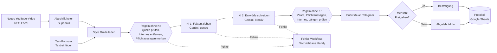

# ⚡ Wissensblitz KI – Content-Repurposing-Pipeline

IHK-Projekt „KI-Tool-Experte“ (MSIT AI Automations & AI Agents), Einzelprojekt von Sebastian Lehnert.

**Problem:** Ich berate kleine Einzelhändler zum Einsatz von KI und gewinne Kunden über YouTube-Videos. Aus jedem Video fünf Texte für andere Kanäle zu schreiben, kostet mich etwa 3 Stunden (eigene Schätzung).

**Lösung:** Ein n8n-Workflow macht aus einem Video oder Text Entwürfe für LinkedIn, X, Instagram, Newsletter, ein Kurzvideo-Skript und eine E-Mail. Feste Regeln prüfen vor und nach der KI. Ich gebe am Handy per Telegram frei. **Nichts wird automatisch veröffentlicht.**

## Architektur

KI arbeitet nur in zwei Schritten (Fakten ziehen, Entwürfe schreiben). Alles Sicherheitskritische sind feste Regeln in Code-Knoten.

## Dateien

| Datei | Inhalt |
|---|---|
| `01_content-pipeline_v2.json` | Hauptworkflow (n8n-Export) |
| `02_fehlermeldung.json` | Fehler-Workflow: meldet Abbrüche per Telegram |
| `daten/` | Synthetische Testquellen und Brand-Style-Guide (alles erfunden) |
| `docs/` | Schriftliche Projektdokumentation (KI-Einsatz-Planung, 6 Kapitel) und Präsentation |

## Startanleitung

**Voraussetzungen:** n8n (Cloud oder selbst gehostet), Google-Konto, Telegram auf dem Handy.

1. In n8n beide JSON-Dateien importieren: neuer Workflow → `…` → *Import from File*.
2. Zugangsdaten anlegen (werden **nicht** mit exportiert):
   - **Google Gemini:** API-Schlüssel aus aistudio.google.com
   - **Telegram:** Bot über `@BotFather` anlegen (`/newbot`), Token eintragen. Eigene Chat-ID über `@userinfobot` herausfinden und in allen Telegram-Knoten statt `DEINE_TELEGRAM_CHAT_ID` eintragen.
   - **Supadata** (nur für den YouTube-Weg): Header Auth, Name `x-api-key`, Wert = Supadata-Schlüssel
   - **Google Sheets:** mit Google-Konto anmelden. Eine Tabelle mit Blatt `Protokoll` anlegen und im Knoten *Ins Protokoll* auswählen.
3. Im Knoten *Neues YouTube-Video* die eigene Kanal-ID statt `DEINE_KANAL_ID` eintragen.
4. In der Pipeline: Einstellungen → *Error Workflow* → `Wissensblitz KI – Fehlermeldung`.
5. Test: Knoten *Test-Formular* → *Test URL* → Titel und Text aus `daten/` einfügen → absenden → Entwürfe kommen per Telegram.

## Markierungen in der Quelle

- `[[INTERN]] … [[/INTERN]]` wird entfernt, **bevor** die KI den Text sieht.
- `[[EXAKT]] … [[/EXAKT]]` muss wörtlich übernommen oder ganz weggelassen werden. Veränderte Wiedergabe wird gemeldet.
- `[PRÜFEN]` setzt die KI hinter unsichere Behauptungen.

## Testszenarien

| Nr. | Eingabe | Erwartung |
|---|---|---|
| T01 | Transkript, schwach strukturiert | Entwürfe für alle Kanäle |
| T02 | Blogbeitrag mit Pflichtaussagen | Pflichtaussagen wörtlich oder weggelassen |
| T03 | Webinar-Bericht mit 3 internen Abschnitten | „Interne Abschnitte entfernt: 3“, nichts Internes in den Texten |
| T04 | Quelle mit zwei Sätzen | Stopp + Fehlermeldung aufs Handy |
| T05 | Leere Quelle | Formular verlangt Pflichtfeld |
| T06 | Quelle mit unbelegten Behauptungen | `[PRÜFEN]` oder weggelassen |
| T07 | Falscher API-Schlüssel | Stopp + Fehlermeldung aufs Handy |
| T08 | Englische Quelle | Deutsche Entwürfe |
| T09 | Offene `[[INTERN]]`-Markierung | Stopp |
| T10 | Fast nur internes Material | Stopp |

Ergebnisse jedes Laufs stehen im Google-Sheet `Protokoll`.

## Datenschutz und Grenzen

- Verarbeitet werden nur eigene Inhalte und erfundene Testdaten, keine personenbezogenen Daten.
- Die Quelle geht an Google Gemini (USA). Für echte Kundendaten wären ein Vertrag zur Auftragsverarbeitung (AVV) und ein Anbieter mit Servern in der EU oder ein lokales Modell nötig.
- Interne Abschnitte werden nur erkannt, wenn sie markiert sind.
- Veröffentlichung (z. B. über Buffer) ist bewusst noch nicht angebunden. Ein Mensch prüft jeden Text.
- Im Echtbetrieb werden nur Videos des eigenen Kanals verarbeitet.

## KI-Unterstützung

Workflow und Dokumentation wurden mit Unterstützung von KI-Assistenten (Claude) erstellt, vom Verfasser geprüft und getestet.
